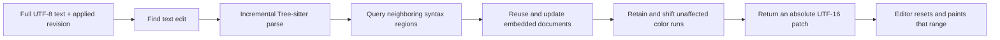

<div align="center">

# tree-sitter-incremental-highlight

**Tree-sitter parses the document. Your editor repaints the part that needs it.**

[](https://github.com/AlmostSensible/tree-sitter-incremental-highlight/actions/workflows/ci.yml)
[](LICENSE)
[](Cargo.toml)
[](CHANGELOG.md)

A persistent Rust highlighting engine with **UTF-16 patches**, **30 language variants**,
and **cached nested language injections**.

[Quick start](#quick-start) · [How it works](#how-it-works) · [Languages](#languages-and-nested-languages) · [Benchmarks](#benchmarks-with-receipts) · [Contributing](CONTRIBUTING.md)

</div>

---

## Why this exists

Typing one character should not require your editor to rediscover the colors of
an entire file. Yet getting from a fast syntax parser to a responsive editor
involves more than putting “incremental” on the box.

The parser works in bytes. Your editor may work in UTF-16. Embedded JavaScript
lives inside HTML, which might itself live inside a Markdown fence. A background
result arrives after the user has already typed something else. And somewhere
in the middle of all this, someone inserts an emoji.

This library grew out of building a native macOS code editor where those problems
were real: repeated full highlighting, expensive color updates, nested languages,
and stale asynchronous results. It packages that work into a reusable Rust engine,
without carrying the original application's UI or runtime along with it.

It is built on **[Tree-sitter](https://tree-sitter.github.io/tree-sitter/)**, its
grammars and its query system. We did not write a new parser. Tree-sitter does
that job rather well already.

Our contribution is the layer around it: persistent highlighting state, selective
query regions, cached child documents, retained color runs and a patch protocol
that an editor can actually apply.

**This is an independent AlmostSensible project, not an official Tree-sitter package.**

## What it solves

| Editor problem | What the library provides |
| --- | --- |
| Full highlighting after a small edit | Incremental parsing and queries over complete neighboring syntax regions |
| Repainting thousands of unchanged colors | A bounded foreground reset range and replacement color spans |
| Byte offsets meeting UTF-16 APIs | Absolute UTF-16 positions, including non-ASCII text and surrogate pairs |
| Languages embedded inside other languages | Cached child parsers, nested injections and interpolation holes |
| A dropped background update | Revision recovery that returns a complete snapshot |
| A new theme, but the same text | A full repaint from cached colors without reparsing |
| “It felt faster on my laptop” | Reproducible fixtures, raw samples and correctness/locality regression checks |

Malformed syntax can legitimately affect distant text, so recovery is conservative.
Sometimes a complete refresh is the correct answer. We prefer correct colors to
confidently incorrect ones.

## Quick start

**Requirements:** Rust 1.88 or later and a C/C++ compiler for the grammar packages.

The first release is **`0.1.0-beta.1`**, distributed through GitHub. Pin the tag
or an exact commit while the beta API settles:

```toml
[dependencies]
tree-sitter-incremental-highlight = { git = "https://github.com/AlmostSensible/tree-sitter-incremental-highlight", tag = "v0.1.0-beta.1" }
```

```rust
use tree_sitter_incremental_highlight::Document;

fn main() -> Result<(), String> {
    let mut document = Document::new("json")?;

    let first = document.update("{\"enabled\":true}", 0, false)?;
    // Your editor applies `first` before advancing its applied revision.

    let changed = document.update(
        "{\"enabled\":false}",
        first.revision,
        false,
    )?;

    assert!(!changed.full);
    println!("Repaint {} UTF-16 units", changed.length);
    Ok(())
}
```

For a complete example that edits text, shifts existing colors, applies the patch
and checks the result against a fresh parse:

```sh
cargo run --locked --release --example editor
```

For Swift and real AppKit text storage:

```sh
# macOS, with Xcode command-line tools installed
bash scripts/test-swift.sh
```

The [Swift example](examples/swift/README.md) demonstrates an owned document handle
and UTF-16 patch application through a small C bridge. It uses JSON to keep the
example readable; it is not a production binding package or a promised stable ABI.
The Rust library itself has no Swift, AppKit, UniFFI or JavaScript runtime dependency.

## How it works



Keep one `Document` per editor and language, and serialize its updates.
The library owns parser/color state; your application owns text storage,
asynchronous scheduling, undo and the color palette.

### Applying a patch correctly

1. Apply the text edit first. Preserve and shift existing color attributes with it.
2. Reset the foreground color in `patch.start..patch.start + patch.length` to your default.
3. Paint the returned spans. Each span has an **absolute UTF-16** start and length.
4. Only then remember `patch.revision` as the last **applied** revision.

All text input is UTF-8. Output positions are UTF-16 code units, not bytes and not
Unicode scalar indices. The distinction is why `🙂` gets two units rather than an
off-by-one bug and a support ticket.

If a worker result belongs to text that has already changed, discard it. Submit
the current text with the last revision you actually painted; a missed revision
requests a complete snapshot. Never paint a stale result onto newer text.

An unchanged normal update returns an empty patch. For a theme change, submit the
same text with `force_full = true`: cached colors produce a complete repaint with
`queried_bytes == 0`.

### Styles are small on purpose

| ID | Category |
| --- | --- |
| `0` | Default / uncolored |
| `1` | Keyword |
| `2` | String |
| `3` | Key, number or constant |
| `4` | Function |
| `5` | Type or builtin |
| `6` | Comment |
| `7` | Added diff text |

Choose your own palette. The eight categories and our overlap priorities are part
of this beta's contract. They do not preserve every upstream capture scope, and
output colors are not claimed to be identical to `tree-sitter-highlight`.

## Languages and nested languages

**30 variants backed by 28 pinned grammar packages:**

Bash · C · C++ · C# · CSS · Diff · Dockerfile · Go · HTML · INI/.env · Java ·
JavaScript · JSON · JSX · Kotlin · Makefile · Markdown · Nginx · PHP · Python ·
Ruby · Rust · SCSS · SQL · Swift · TOML · TSX · TypeScript · XML/SVG · YAML

`Document::new` accepts lowercase keys from `languages::LANGUAGES`, such as
`javascript`, `csharp`, `makefile` and `typescript`.
All grammars are included in this beta; optional per-language build features are
not implemented yet.

Embedded content uses the same patch protocol:

- **HTML:** script/style bodies, including JSON and TypeScript MIME types.
- **PHP:** HTML → JavaScript/CSS, plus named heredoc/nowdoc languages.
- **Markdown:** fences for every supported language, plus embedded HTML blocks.
- **JS/TS/JSX/TSX:** supported tagged templates, including interpolation holes.
- **Dockerfiles and Makefiles:** shell command bodies.

Aliases such as `js`, `py`, `sh`, `yml` and `{.python}` resolve through the registry.
Unknown embedded languages retain host colors; recursion stops at eight child
layers. Disjoint injection regions preserve byte positions and line endings by
masking excluded content before parsing.

## Benchmarks, with receipts

We compare against **`tree-sitter-highlight 0.25.10`** using the same parser,
grammars, queries, injection resolver and eight output styles. Upstream iterators
are fully consumed, with raw events and editor-ready UTF-16 spans measured
separately. No stopwatch is stopped conveniently early.

The default suite contains **101 scenarios** across all 30 variants,
1,000/10,000-entry fixtures, malformed syntax, a large PHP function and
19 embedded workloads. It records 15 samples after two warmups, rotates execution
order and checks each sequential edit against an independent fresh result.

The checked-in historical macOS arm64 baseline showed roughly **1.4–6× faster
local edits in recognized 10,000-entry embedded workloads**. Initial highlighting
was mixed, and unknown fenced languages could be slightly slower. These are
results for specific fixtures, not a universal promise or a faster Tree-sitter parser.

```sh
python3 scripts/benchmark.py

# Focus a run while investigating a change:
HIGHLIGHT_LANGUAGES=html,markdown python3 scripts/benchmark.py

# Enforce a 50% median limit using a baseline from matching dedicated hardware:
python3 scripts/benchmark.py --baseline path/to/baseline.json --timing
```

Raw samples, fixture hashes, resolved child languages and patch/query sizes are
saved in `results/`. Hosted CI enforces correctness, fixture consistency and
locality; its wall-clock timings are informational. Controlled timing gates refuse
mismatched hardware. Compiler/build settings should match too.

The benchmarks measure Rust highlighting, not FFI serialization, UI painting,
editor debounce or total frame latency. See [the methodology and raw baseline](benchmarks/README.md)
for the details, including recorded cross-engine style differences.

## Where the edges are

This library is incremental, but **not guaranteed O(edit-size)**. It receives
full text; diffing, UTF-16 mapping, injection discovery and cache maintenance can
still inspect or copy document-sized data. Large replacements, broad syntax
changes and malformed regions may return complete patches. Queries operate over
whole syntax islands rather than only the changed bytes.

This is syntax coloring. Semantic/LSP coloring, local-variable resolution,
regex/JSDoc/phpdoc grammars and arbitrary template frameworks are outside the
current scope. A small patch is an optimization, not a permission slip to ignore
syntax changes elsewhere.

## Development & compatibility

```sh
cargo fmt --all --check
cargo clippy --locked --workspace --all-targets -- -D warnings
cargo test --locked --release --workspace
cargo package --locked
```

CI covers Linux/macOS, Rust 1.88, packaged-source verification, the Swift/AppKit
example and the complete benchmark comparison. Regression tests check fresh-color
equivalence, Unicode, CRLF, malformed syntax, nested languages, revision recovery
and theme repaints.

We develop this as a reusable library: editor-specific policy stays in consumers,
and changes to language keys, styles, revisions and patch semantics need explicit
compatibility notes. Beta users should pin exact versions. Published tags are
immutable; fixes get a new release.

Read [CONTRIBUTING.md](CONTRIBUTING.md), [CHANGELOG.md](CHANGELOG.md) and
[the validation notes](docs/VALIDATION.md) for the development and release details.

## License

Our implementation is **MIT licensed**. Tree-sitter, its grammars and borrowed
query material retain their original licenses, including Apache-2.0 for the INI
grammar. Full texts are preserved in [THIRD-PARTY-NOTICES.txt](THIRD-PARTY-NOTICES.txt)
and included in the Cargo source package.

See [provenance](docs/PROVENANCE.md) for the extraction and query sources.
Built on excellent upstream work, with a little less repainting.
